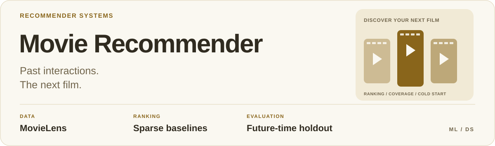
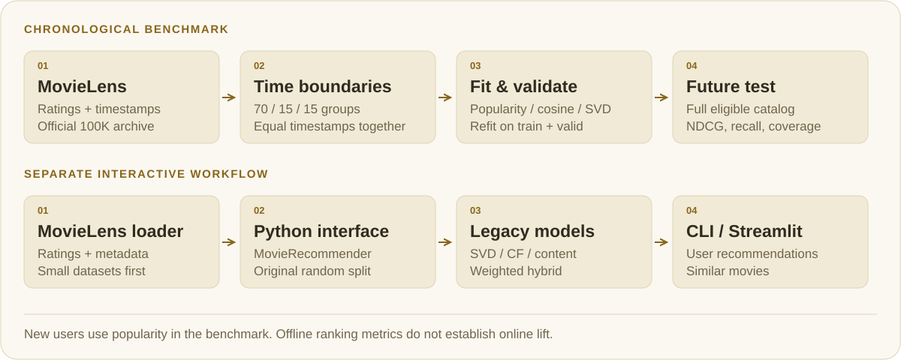

<picture>
  <source media="(max-width: 600px) and (prefers-color-scheme: dark)" srcset="docs/assets/readme/cover-dark-mobile.svg">
  <source media="(max-width: 600px)" srcset="docs/assets/readme/cover-light-mobile.svg">
  <source media="(prefers-color-scheme: dark)" srcset="docs/assets/readme/cover-dark.svg">
  
</picture>

<p align="center">
  <a href="#architecture">Architecture</a> &nbsp;·&nbsp;
  <a href="#chronological-benchmark">Benchmark</a> &nbsp;·&nbsp;
  <a href="#run-locally">Run locally</a> &nbsp;·&nbsp;
  <a href="#python-interface">Python API</a> &nbsp;·&nbsp;
  <a href="#evaluation-and-limitations">Limits</a>
</p>

## Overview

**Recommendation baselines on MovieLens, evaluated on a strict future time period.**

<a id="what-it-does"></a>

Generates recommendations for existing users and finds similar movies. The repository exposes a Python interface, command-line scripts and a Streamlit app.

The research entry point is `src.temporal_benchmark`: train-only popularity,
sparse item cosine, and low-rank SVD evaluated against the full eligible catalog.
The original models and Streamlit workflow remain available separately.

## Architecture

<picture>
  <source media="(max-width: 600px) and (prefers-color-scheme: dark)" srcset="docs/assets/readme/architecture-dark-mobile.svg">
  <source media="(max-width: 600px)" srcset="docs/assets/readme/architecture-light-mobile.svg">
  <source media="(prefers-color-scheme: dark)" srcset="docs/assets/readme/architecture-dark.svg">
  
</picture>

| Path through the project | Entry point | Evaluation contract |
| --- | --- | --- |
| Sparse baseline benchmark | [`src/temporal_benchmark.py`](src/temporal_benchmark.py) | Fixed parameters; validate, refit on train+validation, evaluate the future test period |
| Interactive recommendations | [`src/recommender.py`](src/recommender.py) → [`streamlit_app.py`](streamlit_app.py) | Original random-split workflow and legacy model implementations |

The benchmark ranks the full eligible catalog, excludes previously rated items
and uses popularity for new users. Its numbers do not describe the Streamlit app.

## Chronological benchmark

Measured on the official MovieLens 100K data, 2026-10-24. Complete protocol,
hashes, versions, validation metrics and intervals:
[`reports/temporal_ml100k.json`](reports/temporal_ml100k.json).

| Fixed baseline | Test NDCG@10 | Test Recall@20 | Catalog coverage@10 |
| --- | ---: | ---: | ---: |
| Popularity | 0.2687 | 0.1293 | 4.67% |
| Sparse item cosine, 50 neighbors | 0.2726 | 0.1210 | 7.87% |
| Sparse SVD, 32 factors | 0.2770 | 0.1421 | 17.04% |

There are 219 test users with relevant targets; **142 are absent from fitting**
and receive the same popularity fallback in all methods. Among 72 users with at
least ten earlier ratings, SVD Recall@20 is 0.1854 versus popularity's 0.1448.
This single split does not establish statistical superiority: reported intervals
are user-bootstrap uncertainty conditional on fitted models, not a paired test
of improvements or evidence of online lift.

```bash
# For the recorded benchmark, use Python 3.12 and these numerical versions:
python -m pip install -r requirements-benchmark.txt
python -m src.temporal_benchmark --data-dir data --output reports/temporal_ml100k.json
```

The loader downloads the official MovieLens 100K archive if it is missing.
The benchmark uses global time boundaries at 70% and 85% of unique timestamps;
equal timestamps stay together. Parameters are fixed before evaluation. Each
model is evaluated on validation, then refitted on train+validation for the
future test period. Test interactions never enter popularity, neighbors,
embeddings or user histories.

Recommendations rank every item observed before the evaluation cutoff, with
previously rated items excluded. Ratings of at least four are relevant. Users
with no positive future targets are excluded from ranking averages. New users
fall back to popularity; new items cannot be recommended and remain in recall
and NDCG denominators. This makes cold-start failure visible rather than silently
discarding it.

The JSON report records input SHA-256, split boundaries and sizes, versions,
NDCG@10, Recall@20, coverage@10, user-bootstrap intervals, and slices for new
users, short histories, and unavailable relevant items. Coverage uses the
train-observed catalog denominator. Scoring latency is local single-process
measurement, excluding service/network overhead.

This is an explicit-rating benchmark, not a logged impression experiment. An
unrated movie is not a confirmed negative, and an offline metric is not online
engagement lift. The first observed rating only approximates catalog availability.

## Run locally

Use Python 3.11:

```bash
git clone https://github.com/ssivitskii/Movie-Recommender.git
cd Movie-Recommender
python -m venv .venv
source .venv/bin/activate
python -m pip install -e ".[dev,web]"
```

The data loader downloads MovieLens on first use; network access is required. Supported datasets are `ml-100k`, `ml-1m` and `ml-latest-small`. Start with `ml-100k` because some implementations construct dense matrices.

```bash
# Train and evaluate
python -m src.train --model svd --dataset ml-100k --epochs 20 --evaluate

# Compare implementations; this trains models again
python -m src.evaluate --model all --dataset ml-100k

# Open the web interface
python -m streamlit run streamlit_app.py
```

### Interactive model choices

| Model key | Approach |
| --- | --- |
| `svd` | Matrix factorization |
| `user_cf` | User-based collaborative filtering |
| `item_cf` | Item-based collaborative filtering |
| `content` | Content-based similarity |
| `hybrid` | Weighted combination of SVD, item-based and content models |

**Stack:** Python · NumPy · pandas · SciPy · scikit-learn · Streamlit

### Python interface

```python
from src.recommender import MovieRecommender

recommender = MovieRecommender(dataset="ml-100k", model="svd")
recommender.fit()
recommendations = recommender.recommend_for_user(user_id=1, n=10)
print(recommendations)

# Select model="hybrid" to train the weighted hybrid implementation.
```

## Evaluation and limitations

```bash
python -m pytest
```

The legacy evaluation code computes rating errors (RMSE and MAE) and ranking metrics including Precision@K, Recall@K and NDCG@K. Use the chronological benchmark above for the documented future-period comparison; its results are not interchangeable with the older random-split evaluation.

The legacy app's default data split is random. The hybrid uses fixed weights (SVD 0.5, item-based 0.3, content-based 0.2). Legacy dense matrices limit scalability. The independent chronological runner uses sparse interaction matrices; it still materializes item-neighbor similarities and one user's score vector, so it is intended for MovieLens 100K rather than a web-scale catalog.

Saved model format 2 restores inference, history and evaluation state. The prediction CLI supports `--model-path`, `--show-history` and `--similar-to`. Older model files can still load for inference, but may lack the state needed to evaluate or show history; retrain and save to obtain it. Pickle files must come from a trusted source.

## Repository map

| Path | Purpose |
| --- | --- |
| `src/recommender.py` | Python orchestration interface |
| `src/models.py` | Recommendation algorithms |
| `src/data_loader.py` | MovieLens loading and preparation |
| `src/metrics.py` | Evaluation metrics |
| `src/train.py`, `src/evaluate.py` | Training and comparison CLI |
| `src/temporal_benchmark.py` | Chronological sparse-baseline experiment |
| `streamlit_app.py` | Web interface |
| `notebooks/01_eda.py` | Exploratory analysis script |
| `tests/` | Automated tests |

## License and data

Code: [MIT](LICENSE). MovieLens datasets are provided by [GroupLens](https://grouplens.org/datasets/movielens/) under their own usage terms.

[Contributing](CONTRIBUTING.md) · [Report an issue](https://github.com/ssivitskii/Movie-Recommender/issues)

---

[← Back to portfolio](https://github.com/ssivitskii#selected-work)
